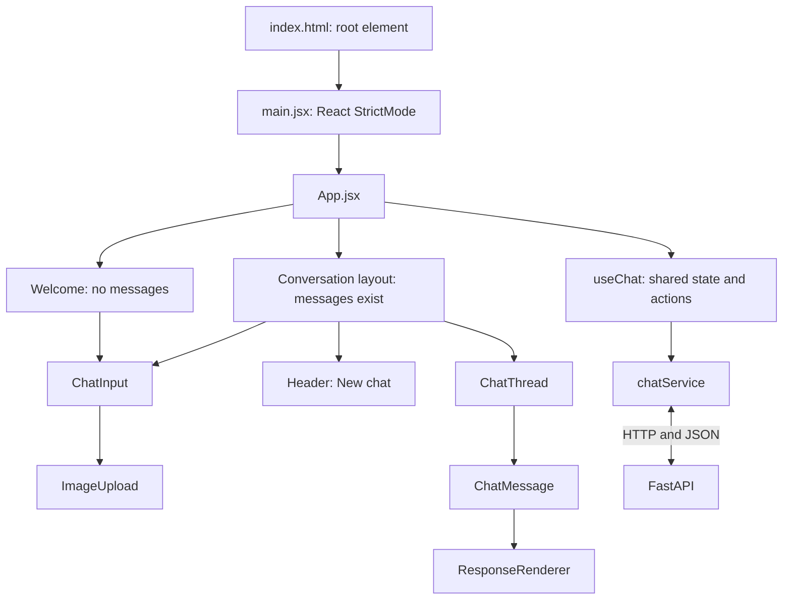

# Manufacturing Equipment Copilot: Frontend Guide

This guide explains the frontend for a beginner: what each file does, how a question reaches the backend, and how the answer appears on screen. It describes the source reviewed on 16 October 2026. Read it alongside the [Backend and Agent Guide](BACKEND_AND_AGENT_GUIDE.md).

## 1. What the frontend does

The frontend is the browser interface for the manufacturing manual assistant. Users can ask questions, upload equipment photos, continue conversations, view manual diagrams and tables, open reference links, and start a new chat.

React manages the interface and browser state. FastAPI manages server sessions, planning, retrieval, model calls and evidence validation. The browser calls FastAPI rather than connecting directly to BigQuery, Cloud Storage, Document AI or Gemini.

Text-only questions are supported even though the input placeholder says “Ask anything about this image...”. An image is optional.

## 2. Technology stack

| Technology | Purpose |
|---|---|
| React / React DOM | Components, rendering, state and effects |
| Vite / React plugin | Development server, hot updates and production builds |
| JavaScript / JSX and CSS | Application logic, markup and styling |
| Browser `fetch` | HTTP calls to FastAPI |
| `FormData` | Multipart question and optional image upload |
| `AbortController` | Cancel pending browser requests |
| `sessionStorage` | Remember session ID and expiry in the browser tab |
| `react-markdown` / `remark-gfm` | Markdown, lists and formatted tables |
| Oxlint | Source linting |
| Node test runner | HTTP service regression tests |

Dependency declarations are in [package.json](frontend/package.json); the lockfile resolves installed versions. There is no Redux store or client-side router in the current application.

## 3. Folder structure

```text
frontend/
  index.html                       HTML entry point and browser title
  package.json                     Dependencies and npm commands
  package-lock.json                Dependency lockfile
  vite.config.js                   React plugin and development server
  run.cmd                          Windows launcher
  tests/
    chatService.test.mjs            Timeout and cancellation tests
  src/
    main.jsx                       Mounts React
    App.jsx                        Welcome / conversation layout
    assets/hero.png                Background image
    components/
      layout/
        GearLogo.jsx               SVG product mark
        Header.jsx                 Chat title and New chat button
        Welcome.jsx                Welcome screen and examples
      chat/
        ChatInput.jsx              Question form and image preview
        ImageUpload.jsx            File picker
        ChatThread.jsx             Message list and scrolling
        ChatMessage.jsx            User / assistant message
        ResponseRenderer.jsx       Text, table, image and link blocks
    config/appConfig.js            API address, uploads, title, examples
    hooks/useChat.js               State, sessions, sending and reset
    services/chatService.js        HTTP calls and response adaptation
    styles/
      global.css                   Base styles
      chat.css                     Page and chat layout
      agent-response.css           Formatted answer styles
    utils/validateImage.js         Initial upload validation
```

The active renderer is `frontend/src/components/chat/ResponseRenderer.jsx`, imported by `ChatMessage.jsx`. The empty duplicate formerly at the repository-level `src/components/ResponseRenderer.jsx` was removed during cleanup. Follow imports from `main.jsx` when identifying active code.

## 4. Installation and startup

Run from the repository root with Node.js/npm installed:

```powershell
# Install from the lockfile.
npm.cmd --prefix frontend ci

# Start the frontend.
.\frontend\run.cmd
```

In another terminal:

```powershell
.\backend\run.cmd
```

Open `http://localhost:5173`. The default API is `http://127.0.0.1:8000`.

`vite.config.js` sets `host: 'localhost'`, port `5173` and `strictPort: true`. An occupied port causes startup to fail instead of switching ports. The interface can load without cloud connectivity, but successful answers require a running, correctly configured backend.

## 5. Configuration

[appConfig.js](frontend/src/config/appConfig.js) centralizes:

| Setting | Value / purpose |
|---|---|
| `appName` | Manufacturing Equipment Copilot; chat header title |
| `apiBaseUrl` | `VITE_API_URL`, otherwise `http://127.0.0.1:8000`; trailing slash removed |
| `chatEndpoint` | `/chat` |
| `maxImageSizeMB` | `5`; validator uses `5 × 1024 × 1024` bytes |
| `allowedImageTypes` | JPEG, PNG and WebP MIME types |
| `exampleQuestions` | Welcome-screen suggestions |

For another backend, create `frontend/.env.local`:

```dotenv
VITE_API_URL=http://127.0.0.1:8000
```

Restart Vite after changing environment settings. The browser origin must also be allowed by backend CORS configuration. There is no API proxy in the current Vite setup; requests go directly to `apiBaseUrl`.

`VITE_*` values are exposed to browser code. Keep Google credentials in the backend environment. The browser title in `index.html` and welcome heading in `Welcome.jsx` are separate from `appName`; changing the config name alone does not rename every heading.

## 6. Startup and component architecture



`App.jsx` calls `useChat()` and passes its state/actions to children through props. When there are no messages, it renders the welcome screen, input and example buttons. Once messages exist, it renders the header, thread and bottom input dock. Clicking an example fills the question field; it does not send automatically.

## 7. Component code map

| File | Responsibility | When used |
|---|---|---|
| [main.jsx](frontend/src/main.jsx) | Mounts `App` inside `React.StrictMode` | Browser startup |
| [App.jsx](frontend/src/App.jsx) | Chooses layout and passes hook state/actions | Relevant state changes |
| [Header.jsx](frontend/src/components/layout/Header.jsx) | Product title/logo and New chat action | Conversation view |
| [Welcome.jsx](frontend/src/components/layout/Welcome.jsx) | Heading, input children and example buttons | Empty conversation |
| [GearLogo.jsx](frontend/src/components/layout/GearLogo.jsx) | Draws SVG logo shapes | Header / welcome rendering |
| [ChatInput.jsx](frontend/src/components/chat/ChatInput.jsx) | Controlled input, selected-image preview/removal and submit | User input |
| [ImageUpload.jsx](frontend/src/components/chat/ImageUpload.jsx) | Opens file picker and passes one selected file upward | Image selection |
| [ChatThread.jsx](frontend/src/components/chat/ChatThread.jsx) | Ordered messages and bottom scrolling | Messages change |
| [ChatMessage.jsx](frontend/src/components/chat/ChatMessage.jsx) | User bubble or assistant loading/error/done display | Each message |
| [ResponseRenderer.jsx](frontend/src/components/chat/ResponseRenderer.jsx) | Renders completed response blocks | Answer arrives |

Send and file selection are disabled during a pending request. The hook also guards duplicate submission. Pressing Enter in the single-line input submits its form.

## 8. State management: `useChat.js`

[useChat.js](frontend/src/hooks/useChat.js) is the central frontend control file.

| State | Contents |
|---|---|
| `question` | Current input text |
| `image` | Selected `File` and preview URL, or `null` |
| `messages` | Browser conversation, including pending/failed turns |
| `loading` | Whether a send operation is pending |
| `error` | Form, startup or session error |
| `session` | Backend session metadata, including request timeout |

The hook uses refs for values needed inside asynchronous work:

| Ref | Purpose |
|---|---|
| `sessionRef` | Access current session without waiting for another render |
| `opening` | Share a pending session-opening promise |
| `generation` | Ignore obsolete responses after reset or expiry |
| `messagesRef`, `imageRef` | Access preview URLs during cleanup |

The hook exports these state values and actions for selecting/removing images, editing the question, sending messages and resetting chat.

## 9. Complete question-to-answer flow

```mermaid
sequenceDiagram
    actor U as User
    participant I as ChatInput
    participant H as useChat
    participant S as chatService
    participant B as FastAPI
    participant R as ChatMessage / ResponseRenderer
    U->>I: Question + optional photo
    I->>H: Submit form
    H->>H: Guard empty/duplicate send; ensure session
    H->>R: Add user message + loading assistant placeholder
    H->>H: Clear submitted text and selected image
    H->>S: sendChat(question, file, session ID, timeout)
    S->>B: POST /chat with multipart FormData
    Note over B: Resolve context, retrieve evidence, generate and validate answer
    B-->>S: JSON blocks and session metadata
    S->>S: Check status; remember session; resolve image URLs
    S-->>H: Adapted response
    H->>H: Ignore obsolete generation; update assistant placeholder
    H->>R: status=done and response
    R-->>U: Text, tables, images and reference links
    opt Image block becomes visible
        R->>B: Browser GET /images/{asset_id}
        B-->>R: Session image bytes
    end
```

File sequence: `ChatInput.jsx` → `useChat.sendMessage()` → `chatService.sendChat()` → backend `/chat` → `checked()` → `absoluteImages()` → update `messages` → `ChatThread.jsx` → `ChatMessage.jsx` → `ResponseRenderer.jsx`.

The UI waits for a complete JSON answer. It does not stream tokens or show backend stage progress; the animated dots indicate a pending request.

Development builds now emit safe timing diagnostics with server/browser request IDs. See the [Latency and Logging Guide](docs/LATENCY_AND_LOGGING_GUIDE.md) for Network headers, console events and measurement boundaries.

## 10. HTTP service and API contract

[chatService.js](frontend/src/services/chatService.js) owns browser/backend communication.

| Function / endpoint | Purpose |
|---|---|
| `openChatSession()` | Restore a valid session or create one |
| `GET /sessions/{id}` | Retrieve metadata and saved messages |
| `POST /sessions` | Create a session |
| `sendChat()` / `POST /chat` | Send question and optional photo |
| `cancelChatRequest()` | Abort active browser fetch |
| `closeChatSession()` / `DELETE /sessions/{id}` | Clear browser metadata and delete backend session |
| `GET /images/{asset_id}` | Browser request generated by an image block |

Multipart fields must match the backend:

```text
session_id    Backend conversation ID
message       Question text; empty for an image-only message
image         Optional File
```

The browser supplies the multipart `Content-Type` boundary automatically. `checked()` parses successful JSON; for an HTTP failure it uses a string `detail` from the backend when available, otherwise a generic status message. The thrown error includes the HTTP status.

## 11. Message and response formats

A user message in React state looks like:

```javascript
{
  id: "browser-generated-id",
  role: "user",
  text: "Explain this component",
  image: "blob:..." // optional local preview
}
```

An assistant placeholder has `status: "loading"`. It becomes `"done"` with `response`, or `"error"` with an error string. `ChatMessage` renders the corresponding state.

Illustrative backend response; values below are examples, not actual machine data:

```json
{
  "blocks": [
    {"type": "text", "content": "A manual-supported explanation."},
    {"type": "table", "title": "Manual values", "columns": ["Item", "Value"], "rows": [["Example", "See manual"]]},
    {"type": "image", "src": "/images/example-asset", "caption": "Manual diagram", "description": "Visible components."},
    {"type": "link", "url": "https://example.com/reference", "title": "Manual reference", "isVideo": false}
  ],
  "asset_warnings": [],
  "session_id": "example-session",
  "expires_at": 1792128600,
  "elapsed_seconds": 12.5
}
```

`absoluteImages()` resolves relative image routes against `apiBaseUrl`, preserving other response fields. Not every metadata field is displayed: elapsed time, for example, does not currently appear as a timing badge.

## 12. Response rendering

| Block | Visible result |
|---|---|
| `text` | Markdown with GitHub-style formatting; table wrapper allows horizontal scrolling |
| `table` | Optional title, column headings and rows in an HTML table |
| `image` | Lazy-loaded image, caption and Markdown description |
| `link` | Valid HTTP/HTTPS link opened in a new tab with `noopener noreferrer` |
| Unknown type | Omitted |

Raw HTML is skipped in Markdown, and Markdown image elements are disallowed. Manual images use explicit image blocks. These browser rules do not replace backend evidence/asset validation.

If an image fails to load, its image element is hidden and “Image unavailable or session expired” appears. Nonempty `asset_warnings` produces a general notice that some original reference media could not load.

Video references and QR destinations are links. The renderer does not embed video players or decode QR codes. Sources arrive as backend-generated text blocks and use the same Markdown renderer.

## 13. Upload and preview lifecycle

1. `ImageUpload` opens a picker with configured MIME types.
2. It passes one file upward and resets the picker value so the same file can be selected again.
3. `validateImage` checks type and size before upload.
4. `selectImage` stores the `File` and creates a preview with `URL.createObjectURL()`.
5. `ChatInput` displays that preview and a removal button.
6. On submission, the user bubble retains its preview while `sendChat` uploads the actual file.
7. Replacement, removal, reset and expiry cleanup revoke relevant preview URLs.

A blob preview is a browser reference, not a cloud asset. Actual image decoding and normalization happen in the backend. The validator permits files up to and including the configured byte limit, although the oversize message says “less than 5 MB.”

## 14. Sessions, refresh and New chat

The browser stores only `session_id` and `expires_at` under `maintenance-chat-session-v2` in `sessionStorage`. Full history and request timeout are not saved there.

At startup, `openChatSession()` checks saved metadata. An unexpired ID triggers a backend GET to restore messages and current settings. A missing/expired server session (`404`/`410`) triggers creation of a new session; other errors are surfaced.

Restored messages receive new browser IDs. Assistant messages are marked `done`. User images in server history are data URLs; fresh local previews use blob URLs.

`resetChat()` increments the generation counter, cancels fetch, releases preview URLs, clears local state, deletes the old server session and opens another. A late response from the old generation is ignored.

An effect schedules expiry cleanup using server `expires_at`, clears the interface and displays an expiry message. The backend allows a TTL up to one hour. The frontend message says “one-hour session” even if the backend uses a shorter TTL.

Server sessions and response images are in memory. A backend restart can invalidate remembered browser sessions.

## 15. Follow-ups, typos and document inventory

The frontend sends original user text with the same session ID. It does not run a local spellchecker, rewrite technical identifiers or resend an earlier photo file on every message.

The backend resolves requests such as “explain it,” “above image” and ordinary typos using conversation/photo context. It retains the latest validated photo even after an answer fails, and decides whether that photo is relevant to the next question.

“How many machine documents u have” uses the same `/chat` endpoint. Backend inventory routing queries the complete catalog and returns ordinary text blocks containing counts and document names. No separate frontend inventory page is needed.

“The required information is not available in the provided PDF manuals” is backend answer content, not a browser transport error. If unexpected, investigate routing, planning, retrieval and evidence rather than treating it as a failed HTTP request.

## 16. Timeout and error handling

Session responses include `request_timeout_seconds`. The hook passes this into `sendChat`:

```text
browser timeout = (valid server timeout + 15 seconds) × 1000
fallback server timeout = 120 seconds
```

For a server timeout of 500 seconds, the browser waits 515 seconds. This allows a backend timeout response to arrive first; it does not make processing faster.

| Situation | Display / handling |
|---|---|
| Invalid image | Form-level validation error; no upload |
| Empty text and no image | Submission ignored |
| Pending answer | Animated dots; send and picker disabled |
| HTTP failure | Backend string `detail`, when supplied, in assistant error bubble |
| Browser deadline | “The answer took too long. Please try again.” |
| Cancellation | “The request was cancelled.”; obsolete-generation updates ignored |
| Fetch `TypeError` | Backend connection message; Network/console can distinguish CORS from connectivity |
| Chat HTTP `410` | Saved session metadata removed; error surfaced |
| Missing reference image | Image fallback or response media warning |

There is no automatic chat retry or dedicated Retry button. Failed turns remain in browser state until reset/expiry; refresh restores server-recorded history, which may omit failed turns. Session create/get/delete requests do not currently use the chat timeout timer.

## 17. Styling and scrolling

`global.css` provides the reset, fonts and base colors. `chat.css` owns the background, welcome layout, input form, sticky header/bottom dock, bubbles, loading dots and table wrappers. `agent-response.css` refines Markdown typography, tables, images, captions and links.

The background is `src/assets/hero.png`. Conversation mode adds a pale gradient for readability. `GearLogo` generates SVG; `index.html` loads Inter from Google Fonts, with local fallback fonts in CSS.

Some response selectors exist in both chat and answer styles. Check import order and CSS specificity when edits appear ineffective. `ChatThread` scrolls the bottom marker into view on `messages` changes; late image loading is not a separate scroll trigger.

## 18. Verification and production build

From the repository root:

```powershell
node --test frontend/tests/chatService.test.mjs
npm.cmd --prefix frontend run lint
npm.cmd --prefix frontend run build
npm.cmd --prefix frontend run preview
```

Service tests cover configured/fallback deadlines and distinct timeout/cancellation messages, with mocked HTTP and timers. They do not exercise React components, a real browser or Google services. There is no `npm test` script currently.

Vite writes builds to `frontend/dist/`. Preview is for locally checking a build; backend hosting remains separate. Supply the intended `VITE_API_URL` when building for another environment.

For manual verification: send text, upload an image, ask a follow-up without reuploading, request the inventory, refresh to restore history, and use New chat. Check tables, image captions/fallbacks and reference links when the backend returns them.

## 19. Troubleshooting map

| Symptom | First checks |
|---|---|
| Page does not open | Vite terminal and port 5173 conflict |
| Backend connection error | API URL, backend process, Network tab and CORS |
| Long loading / timeout | `/chat` status/duration, backend stage logs and session timeout |
| Inventory says unavailable | Backend inventory routing and catalog query |
| Follow-up loses photo | Same session ID, backend retained upload and planner selection |
| Diagram fails | `/images/{asset_id}`, server session expiry and asset warnings |
| Video opens a new tab | Expected: current implementation renders links |
| Refresh loses messages | Backend restart/expiry, sessionStorage and session GET |
| Old response after reset | Generation guards and cancellation |
| Layout/formatting issue | CSS imports/selectors, background asset and viewport |

## 20. Where to make changes

| Change | Starting file |
|---|---|
| API address / examples / upload settings | `frontend/src/config/appConfig.js` |
| Browser title | `frontend/index.html` |
| Welcome heading | `frontend/src/components/layout/Welcome.jsx` |
| Header | `frontend/src/components/layout/Header.jsx` |
| Input / preview controls | `frontend/src/components/chat/ChatInput.jsx` |
| State and session behavior | `frontend/src/hooks/useChat.js` |
| HTTP requests and deadlines | `frontend/src/services/chatService.js` |
| New response block | `frontend/src/components/chat/ResponseRenderer.jsx`, plus backend schema/builder |
| Answer formatting | `frontend/src/styles/agent-response.css` |
| Incorrect technical answers | Backend planner, retrieval, instructions and evidence validation |

Upload restriction changes must also agree with backend validation. Frontend state explains what the browser displays; backend state and evidence explain what the assistant can answer.
