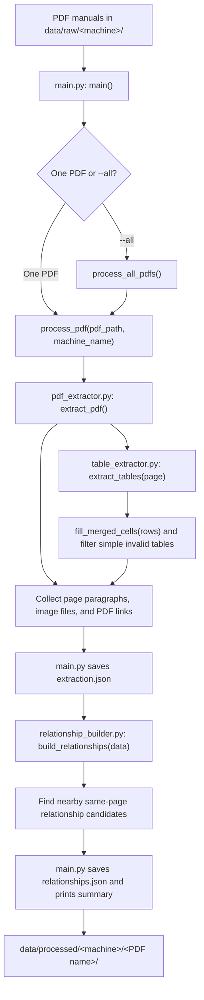

# Manufacturing Manual PDF Processing

This project reads machine manuals from PDF files and saves their text,
tables, pictures, links, and nearby-element suggestions as JSON. It uses
PyMuPDF and runs locally.

> **Current scope:** The code extracts and organizes PDF content. It does not
> yet create embeddings, search a vector database, or answer questions with an
> LLM. The table chunk helper exists, but the main processing command does not
> call it.

## Process flow



## What happens at each stage

| Stage | File and function | In simple words |
| --- | --- | --- |
| 1. Choose PDFs | `main.py`: `main()`, `process_all_pdfs()` | Process one named PDF, or find PDFs under `data/raw` when run with `--all`. For batch mode, the first folder under `data/raw` is treated as the machine name. |
| 2. Process a manual | `main.py`: `process_pdf()` | Check the PDF path, create its output folders, call the extractor, save its results, build relationship suggestions, and print counts. |
| 3. Extract page content | `pdf_extractor.py`: `extract_pdf()` | Go through the PDF pages. Keep text blocks that do not substantially overlap a detected table. Extract image placements and web links. |
| 4. Read tables | `table_extractor.py`: `extract_tables()` | Use PyMuPDF to find tables. Keep tables with at least two rows and two columns and some non-empty content. |
| 5. Normalize merged cells | `table_extractor.py`: `fill_merged_cells()` | Repeat a blank first-column value from the previous row. This is a simple heuristic, not confirmed PDF layout analysis; review the affected tables. |
| 6. Suggest relationships | `relationship_builder.py`: `build_relationships()` | Compare positions of text, tables, images, and links on the same page. Save nearby items as candidates; proximity does not prove that they are related. |
| 7. Save results | `main.py`: `process_pdf()` | Write the extracted content to `extraction.json`, suggestions to `relationships.json`, and print page/content counts. |

## Run it

From the repository root in PowerShell:

Process all PDFs under `data/raw`:

```powershell
.\.venv\Scripts\python.exe .\src\simple_ingestion\main.py --all
```

Process one PDF. The machine name must match its folder under `data/raw`:

```powershell
.\.venv\Scripts\python.exe .\src\simple_ingestion\main.py `
  ".\data\raw\HSG-2550\7 - Haas Surface Grinder - Troubleshooting.pdf" `
  "HSG-2550"
```

If the project environment is not set up yet, install its listed dependencies:

```powershell
.\.venv\Scripts\python.exe -m pip install -r .\src\simple_ingestion\requirements.txt
```

## Input and output folders

Put source manuals under a machine folder:

```text
data/
└── raw/
    └── HSG-2550/
        └── troubleshooting.pdf
```

Each processed PDF gets its own folder:

```text
data/
└── processed/
    └── HSG-2550/
        └── troubleshooting/
            ├── extraction.json
            ├── relationships.json
            └── assets/
                └── images/
```

### Output files

| Output | What it contains |
| --- | --- |
| `extraction.json` | The PDF name and page-by-page paragraphs, tables, image locations, and web links. |
| `relationships.json` | Nearby-element suggestions for each image, table, and link, grouped by page. They are candidates, not verified meanings. |
| `assets/images/` | Image files extracted from the PDF. JSON image records point to these files. |

## Important limitations

- Table merge handling fills down only the first column and may mistake a truly
  empty cell for a merged one.
- Text blocks that overlap table areas are skipped to avoid duplicating table
  text; unusual layouts may cause text to be skipped.
- Relationship suggestions use same-page distance only. They can connect
  nearby but unrelated content, and they do not cross page boundaries.
- The extractor does not run OCR. Scanned pages may have pictures but little
  or no searchable text.
- The main command does not create semantic chunks, embeddings, or a searchable
  vector index. `chunk_builder.py` contains a table-row chunk helper, but it is
  not currently called by `main.py`.

## Code files

| File | Purpose |
| --- | --- |
| `src/simple_ingestion/main.py` | Command-line entry point; runs a single PDF or a batch and saves JSON outputs. |
| `src/simple_ingestion/pdf_extractor.py` | Extracts paragraphs, tables, images, and links from PDF pages. |
| `src/simple_ingestion/table_extractor.py` | Finds tables, applies the first-column fill-down heuristic, and filters basic invalid detections. |
| `src/simple_ingestion/relationship_builder.py` | Finds nearby same-page candidate relationships; can also run directly on an existing extraction JSON. |
| `src/simple_ingestion/chunk_builder.py` | Provides a helper for formatting table rows as chunks; not wired into the main flow. |
| `src/simple_ingestion/inspect_output.py` | Example script for printing the extracted data from a specific processed PDF. |

## Run tests

From the repository root:

```powershell
.\.venv\Scripts\python.exe -m unittest discover -s tests -p "test_*.py"
```
