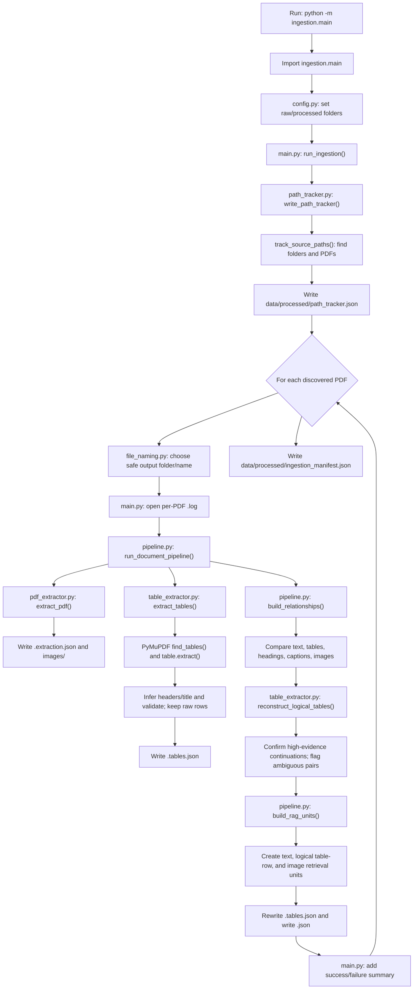

# PDF ingestion code flow

This guide follows the code from the moment `ingestion.main` is run until the
output files are written. It explains the main functions in everyday language
and points out what each stage receives and returns.

## Quick picture



The loop means each PDF gets its own output folder and log. A failure for one
PDF is recorded, and the loop continues with the next PDF.

## Starting the program

From the repository root, the usual command is:

```powershell
.\.venv\Scripts\Activate.ps1
Set-Location .\src
python -m ingestion.main
```

Python imports `ingestion.main` and its dependencies first. Importing
[`config.py`](../src/ingestion/config.py) determines the project root and
sets:

- `RAW_DATA_DIR` to `data/raw`
- `PROCESSED_DATA_DIR` to `data/processed`

It also creates those directories if they do not already exist. The final
lines of [`main.py`](../src/ingestion/main.py) check whether this file was run
as the program entry point. When it was, they call `run_ingestion()`.

## Whole-run functions, in order

### 1. `run_ingestion()` — `main.py`

This is the coordinator for the full batch. It:

1. Makes sure the processed output directory exists.
2. Calls `write_path_tracker()` to make an inventory of source folders and
   PDFs.
3. Loops over the discovered PDFs one at a time.
4. Creates a per-PDF output folder and log.
5. Calls `run_document_pipeline()` for that PDF.
6. Records the result as a success or failure.
7. Writes a batch-wide `ingestion_manifest.json` after the loop finishes.

The `try` / `except` is around each PDF, not around the whole batch. That is
why a damaged or unreadable PDF does not prevent the remaining PDFs from
being attempted. A failure is added to the manifest and its traceback is
written to that PDF's log.

### 2. `write_path_tracker()` and `track_source_paths()` — `path_tracker.py`

`write_path_tracker()` calls `track_source_paths()` and saves its result as
`data/processed/path_tracker.json`.

`track_source_paths()` walks down through `data/raw` and records:

- Folder paths relative to `data/raw`
- Files whose extension is `.pdf` (case-insensitive)
- Each PDF's relative path, filename, and machine folder name

Other file types are ignored. Relative paths keep the inventory usable if the
project folder is moved to another computer. If the raw folder is missing or
is not a folder, the function raises an error rather than pretending the scan
succeeded.

### 3. Safe output naming — `file_naming.py`

For each PDF, `run_ingestion()` calls:

- `document_output_directory()` to build a destination reflecting the source
  machine and nested folders
- `safe_filename_stem()` to get a readable output name from the PDF filename

These functions replace characters that are unsafe in filenames. The
original filename is still preserved in the JSON metadata. For example:

```text
Source:
data/raw/HSG-2550/1 - Haas Surface Grinder - Introduction.pdf

Output folder:
data/processed/documents/HSG-2550/1 - Haas Surface Grinder - Introduction/
```

### 4. `run_document_pipeline()` — `pipeline.py`

This function processes one PDF. It first calculates the source-relative
path and output folder, then runs the extraction stages:

```text
extract_pdf()
extract_tables()
build_relationships()
build_rag_units()
summarize validation
write combined document JSON
```

The `logger` passed in from `run_ingestion()` lets this function put
completion details and warnings in the matching per-PDF `.log` file.

## What happens inside the extraction stages

### Text, links, images: `extract_pdf()` — `pdf_extractor.py`

`extract_pdf()` uses PyMuPDF to open the source PDF and walk through its
pages. It calculates the PDF's SHA-256 hash and uses the first 16 characters
as its `document_id`.

For every page, it:

1. Reads page text in PyMuPDF's sorted reading order.
2. Keeps separate text blocks instead of flattening everything into one
   paragraph.
3. Saves each block's text, zero-based PDF page index, one-based page number,
   bounding box, reading order, and font/span details. A printed page number
   is left `null` because it is not reliably distinguishable from page text.
4. Calls `classify_text_block()` to label a block as a caption, section
   heading, or paragraph. This is a layout-based guess, not a guarantee.
5. Records links and their page positions.
6. Extracts embedded image data, saves each unique byte asset once under
   `images/`, and records a separate image occurrence for every page
   placement. Occurrences point to the shared asset and retain their own
   page index and bounding box.
7. Adds warnings when a page has no readable text. If it contains images but
   no text, it flags that OCR may be needed; it does not run OCR.

`calculate_file_hash()` reads the PDF in chunks to compute its SHA-256.
`extract_pdf()` writes its result to `<stem>.extraction.json` and returns the
same information to the document pipeline.

### Tables: `extract_tables()` — `table_extractor.py`

PyMuPDF remains the first-pass table parser. For every page,
`extract_tables()` calls `page.find_tables()` and then calls
`table.extract()` on each found table.

During the coordinated pipeline it reuses the SHA-256 already calculated by
`extract_pdf()`, so a large PDF is not read a second time just to identify the
tables. Calling `extract_tables()` directly still calculates the hash itself.

Before interpreting the rows, the code preserves the extracted cell values
and the table bounding box. Helper functions then clean cell whitespace and
look for a plausible structure:

- `_infer_table_structure()` considers row shapes and the rows that follow;
  it does not depend only on a fixed list of header words.
- `_header_candidate()` compares possible header rows with later rows.
- Sequentially numbered first-column rows are retained as data instead of
  being mistaken for a header just because their other cells contain labels.
- `_expand_vertical_merged_cells()` uses PyMuPDF cell rectangles to repeat a
  value only into rows demonstrably covered by that merged cell. Original
  `raw_rows` remain unchanged; the geometry-normalized rows are stored
  separately and used for table records and logical continuation.
- `_is_multi_level_header()` and `_combine_header_levels()` try to join
  parent and child header labels when the layout gives enough evidence.
- `extract_merged_title()` checks for a title-like merged first row.
- `_records_from_rows()` associates data values with inferred column names.
- `validate_table()` checks for issues such as inconsistent row widths,
  empty or repeated headers, and suspicious page-wide detections. Its
  structured signals include page coverage, generic headers, large one-row
  text, and numbered-list-like content. A large bounding box alone does not
  make a table a false positive.
- `_fallback_metadata()` records whether the result should be reviewed by a
  future fallback process.

Uncertain or suspicious tables are retained with warnings and raw rows; they
are not silently discarded. The table's `extraction_method` currently says
`pymupdf`. A fallback can be requested in metadata, but automatic
recovery of arbitrary cell boundaries from flattened text and OCR are not
implemented yet.

`extract_tables()` first writes `<stem>.tables.json`. Later,
`run_document_pipeline()` adds relationship/context information to the table
records and writes that file again. The final version is therefore the one
to inspect after a full run.

## How relationships are formed

`build_relationships()` in `pipeline.py` connects extracted elements using
text and page layout clues. It calls `match_table_text_blocks()` to compare
text-block words with raw table text and flag likely duplicates.

It can record relationships such as:

- A text block or table appears after a section heading.
- A labeled figure/table caption is close to a possible image/table.
- An image is close to a text block on the same page.
- A paragraph explicitly refers to a figure or table.

Each relationship stores evidence and a confidence score. A nearby block is
only a possible context match, not proof that it describes the image or table.
The pipeline also attaches available section context to tables before
rewriting the final `<stem>.tables.json`.

### How cross-page tables are reconstructed

After page-level tables are extracted and their context is attached,
`reconstruct_logical_tables()` compares candidates on consecutive pages. A
join requires matching document identity, a previous table near the bottom and
a next table near the top, overlapping horizontal bounds, compatible column
counts, and either sequential row numbers, a repeated header with compatible
section evidence, or matching value shapes across columns with the same
section context. One clue by itself cannot confirm a join.

Confirmed logical records keep each page-level table ID, bounding box, header,
and raw row array. Every logical row maps back to its source fragment, page,
bounding box, and raw-row index. The original page-level table records remain
available in `<stem>.tables.json`; their rows are excluded from RAG when the
logical table emits the same content, preventing duplicates. If the edge and
column evidence is plausible but the rows or headers are ambiguous, the
pipeline records a `continues_table` candidate and excludes the uncertain
fragment from table-row RAG rather than claiming it was reconstructed.
Path-like footer rows accidentally captured inside a table are kept in the
fragment's `raw_rows` and noted in logical-table warnings, but are not emitted
as logical table rows.

The current continuation logic does not split a long flattened text cell into
new cells. It uses rows and cell boundaries already found by PyMuPDF and
requires structural evidence before combining them.

When PyMuPDF also reports a page-wide wrapper around a cross-page table, that
wrapper remains preserved and flagged as a probable false positive. The
row-level table fragment is used for reconstruction when its own geometry and
row structure provide sufficient evidence. Repeated values from vertically
merged cells are carried into normalized table rows only when the cell
rectangle covers those rows; the original extraction remains available for
comparison. For confirmed headerless continuation fragments, the page-level
record exposes the logical table's inherited headers and rows while retaining
the local parser's original headers/rows under `detected_headers`,
`detected_rows`, and `detected_header_source`. Header warnings resolved by this
confirmed relationship are moved to `resolved_header_warnings`; the original
extraction warnings remain available for audit.

## How retrieval units are built

`build_rag_units()` prepares smaller, page-addressable pieces for a future
search system. It returns a list used in the combined `<stem>.json`:

- **Text unit:** text from a page block, with its page, location, and section
  context.
- **Table-row unit:** a row rendered with its column names when known, plus
  table/page/context and validation information.
- **Logical table-row unit:** when adjacent page fragments are confirmed as
  one table, each row uses the shared headers but retains the page-level
  fragment ID and source page that supplied the row.
- **Image unit:** a reference to the saved image, page, location, and any
  caption or nearby text that the relationship step could associate with it.
  Such context remains marked as a candidate relationship with its evidence
  and confidence; it is not upgraded to a confirmed description.

If a text block almost exactly repeats a table and has at least eight words,
it may be left out of the retrieval units when token overlap is at least 95%.
The original extracted text is still preserved in the extraction JSON. A
caption associated with an image is joined into that image's retrieval unit
instead of being separately indexed again.

A table marked as a probable page-wide false positive also stays in the table
JSON with its raw rows, but is explicitly excluded from table-row retrieval
units. Its `included_in_rag_units` flag and `rag_exclusion_reason` explain why
it was not emitted as a usable table chunk.

These are retrieval-ready records only. This code does not create embeddings,
call an LLM, or save data to a vector database.

## Output files and where to look

The batch creates:

| Path | What it tells you |
| --- | --- |
| `data/processed/path_tracker.json` | Which folders and PDF files were discovered. |
| `data/processed/ingestion_manifest.json` | The overall batch result and per-PDF success/failure counts and output paths. |

For each source PDF, its matching output folder contains:

| File or folder | What it contains |
| --- | --- |
| `<stem>.extraction.json` | Source details, pages, text blocks, span positions/styles, links, image records, and extraction warnings. |
| `<stem>.tables.json` | Detected tables, raw rows, normalized headers/rows where possible, positions, validation, and fallback-review metadata. |
| `<stem>.json` | Combined document record: provenance, tables, relationships, validation summary, and RAG units. |
| `<stem>.log` | Start/completion messages and extraction/table warnings; failures include exception details. |
| `images/` | The extracted image files referenced from the JSON. |

The main JSON points to the extraction and table files by filename. The image
paths recorded in JSON are relative to that PDF's output folder.

The combined JSON has an `elements` index with shared types (`heading`,
`paragraph`, `list`, `caption`, `table`, and `image`). These records contain
provenance and a `content_ref` to the original extraction/table content, so
the same text or image bytes are not copied into a second element store.
Document validation records missing files, invalid references, absent
provenance, malformed table alignment, and relationships without evidence.
The manifest carries document-level warnings alongside each PDF's status.

### Example from the current introduction PDF output

The generated record for `1 - Haas Surface Grinder - Introduction.pdf`
reports one page, zero detected tables, two images, and eleven retrieval
units. Those units represent the page's extracted text and its two images.
The zero table count means PyMuPDF did not detect a table in that PDF; it
does not prove that every possible table-like layout would always be found.

## Full function call outline

This list gives the main call order. Small helper calls inside each stage are
described above.

```text
main.py
└── run_ingestion()
    ├── path_tracker.py: write_path_tracker()
    │   └── track_source_paths()
    ├── for each PDF:
    │   ├── file_naming.py: document_output_directory()
    │   ├── file_naming.py: safe_filename_stem()
    │   └── pipeline.py: run_document_pipeline()
    │       ├── file_naming.py: safe_filename_stem()
    │       ├── file_naming.py: document_output_directory()
    │       ├── pdf_extractor.py: extract_pdf()
    │       │   ├── calculate_file_hash()
    │       │   └── classify_text_block() [for each text block]
    │       ├── table_extractor.py: extract_tables()
    │       │   ├── _infer_table_structure()
    │       │   ├── validate_table()
    │       │   └── _fallback_metadata()
    │       ├── pipeline.py: build_relationships()
    │       │   └── match_table_text_blocks()
    │       ├── table_extractor.py: reconstruct_logical_tables()
    │       ├── pipeline.py: build_rag_units()
    │       └── write the combined <stem>.json
    └── write ingestion_manifest.json
```

## Current limits to keep in mind

- PyMuPDF provides the first-pass extraction. Warnings are signals to review,
  not a promise that all content is accurate.
- OCR is not run, so scanned pages with no selectable text need a later OCR
  stage.
- A general coordinate-based fallback for recovering arbitrary cell
  boundaries from flattened text is not implemented. The conservative
  logical-table stage only combines already-structured page fragments.
- Captions, headings, and nearby-image context are based on layout heuristics.
  Review them before using them as authoritative maintenance guidance.
- The generated JSON files are not yet indexed for retrieval: embeddings and
  a vector store are future stages.
