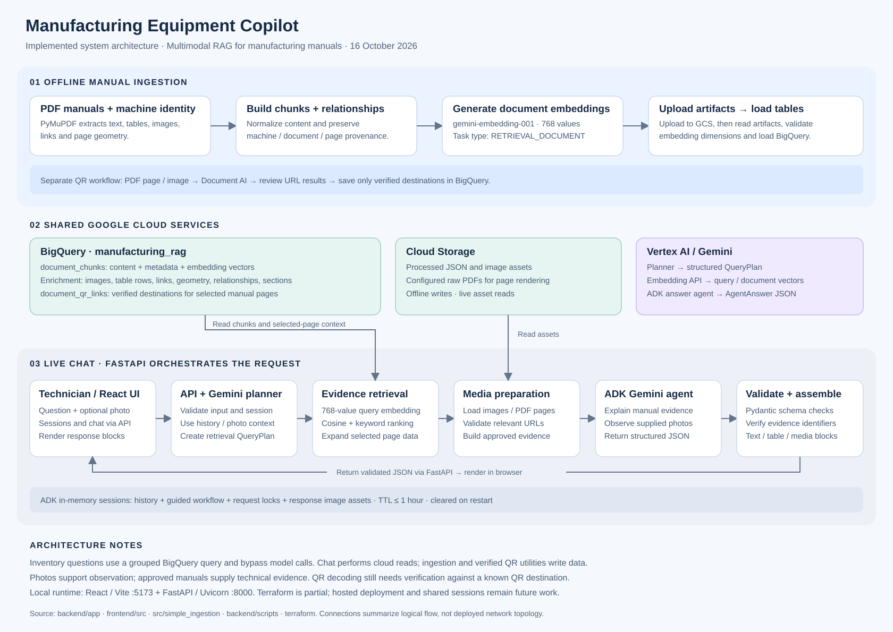
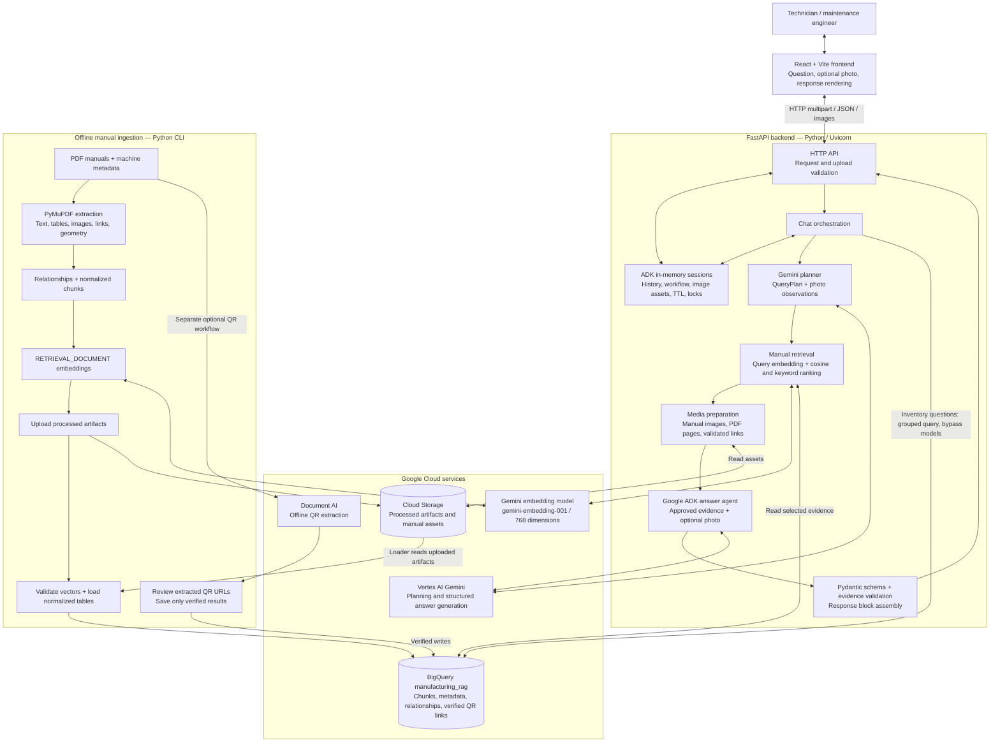

# Manufacturing Equipment Copilot — System Architecture

Architecture derived from the repository source on 16 October 2026. This describes the implemented application; it does not assert that cloud services are currently reachable or that the application is deployed.

The copilot uses multimodal retrieval-augmented generation (RAG) to answer technicians' questions from manufacturing manuals. An offline pipeline prepares searchable manual evidence. During chat, the backend retrieves that evidence, asks Gemini to explain it, validates the structured result, and returns text, tables, images, and relevant links.



## Component architecture



Arrows represent calls or data flow. The chat orchestrator coordinates retrieval, media preparation, generation, and validation; the answer agent receives a prepared evidence bundle rather than choosing arbitrary database tools.

## Live question flow

```mermaid
sequenceDiagram
    actor T as Technician
    participant F as React frontend
    participant A as FastAPI / orchestrator
    participant S as In-memory session store
    participant G as Gemini / Vertex AI
    participant B as BigQuery
    participant C as Cloud Storage
    T->>F: Question + optional equipment photo
    F->>A: POST /chat (session ID, multipart input)
    A->>S: Validate session, acquire lock, read context
    alt Document inventory request without photo
        A->>B: Group machine_name and document_name
        B-->>A: Available manuals
    else Technical question
        A->>G: Plan query using question, context, optional photo
        G-->>A: QueryPlan or clarification
        opt Plan permits retrieval
            A->>G: RETRIEVAL_QUERY embedding (768 dimensions)
            G-->>A: Query vector
            A->>B: Rank document_chunks by cosine distance + keyword bonus
            B-->>A: Seed chunks
            A->>B: Same-page context, related metadata, verified QR links
            B-->>A: Approved evidence bundle
            opt Relevant manual images / PDF pages needed
                A->>C: Load selected assets
                C-->>A: Manual asset bytes
            end
            A->>G: ADK generation with evidence, allowed media, optional photo
            G-->>A: AgentAnswer JSON
            A->>A: Validate schema and evidence IDs; assemble blocks
        end
    end
    A->>S: Record history, workflow state, response assets
    A-->>F: Structured JSON response
    F-->>T: Text, tables, images, source/video links
    opt Image block displayed
        F->>A: GET /images/{asset_id}
        A->>S: Read session-owned asset
        A-->>F: PNG image
    end
```

## Storage model

| Storage | Responsibility | Access path |
|---|---|---|
| BigQuery `document_chunks` | Text, content type, machine/document/page identity, embedding model, dimension, and vector | Initial semantic retrieval and document inventory |
| `document_chunk_geometry` | Page coordinates for a chunk | Enrich selected evidence |
| `document_images` | Image identifiers and asset paths | Enrich selected evidence |
| `document_table_rows` | Extracted table rows | Enrich selected evidence |
| `document_links` | URLs embedded in manuals | Enrich selected evidence |
| `chunk_relationships` | Relationships between source and target elements | Enrich selected evidence |
| `document_sections`, `section_elements` | Section hierarchy and element membership | Enrich selected evidence |
| `document_qr_links` (configurable) | Manually verified QR destinations and provenance | Read for selected machine/document/pages |
| Cloud Storage | Uploaded processed JSON and image assets; configured raw PDFs support page rendering | Offline writes; live asset reads |
| Backend process memory | ADK sessions, recent history, guided workflow, locks, response image assets, caches | Session lifecycle and image serving |

The semantic entry point is always `document_chunks`. Ranking currently uses BigQuery `ML.DISTANCE(..., 'COSINE')` plus a keyword bonus. Related tables enrich selected chunks; the implementation does not use a separate vector database or a BigQuery `VECTOR_SEARCH` index. Explicit multi-machine requests retain candidates per mentioned machine before context assembly.

Document and query embeddings share `gemini-embedding-001` and 768 dimensions, with `RETRIEVAL_DOCUMENT` and `RETRIEVAL_QUERY` task types respectively. The loader rejects incompatible vectors.

## API and code ownership

| Layer | Main files | Responsibility |
|---|---|---|
| Browser | `frontend/src/App.jsx`, `hooks/useChat.js`, `services/chatService.js`, `components/chat/ResponseRenderer.jsx` | Session lifecycle, uploads, HTTP calls, response rendering |
| API | `backend/app/main.py`, `api/*_routes.py` | Routing, CORS, validation, timeouts, error responses |
| Orchestration | `backend/app/agent/chat_service.py` | Inventory shortcut, planning, evidence preparation, ADK execution, workflow updates |
| Models | `backend/app/agent/planner.py`, `agent.py`, `instructions.py` | Query planning and grounded answer generation |
| Retrieval | `backend/app/retrieval/embeddings.py`, `manual_search.py`, `bigquery_client.py`, `qr_link_search.py` | Query vectors, ranked evidence, enrichment, verified QR reads |
| Media | `backend/app/media/prepare_media.py`, `manual_images.py`, `video_links.py` | Asset loading, PDF rendering, image normalization, URL validation |
| Response | `backend/app/responses/schemas.py`, `response_builder.py` | Typed results, evidence ID checks, final blocks |
| Sessions | `backend/app/sessions/session_store.py` | Temporary state, request serialization, asset ownership and expiration |
| Ingestion | `src/simple_ingestion/pipeline.py` and extraction/embedding/upload/loader modules | Manual-to-searchable-evidence pipeline |
| QR workflow | `backend/scripts/extract_qr_links.py`, `save_qr_links.py` | Offline extraction, review artifact, verified storage |

Public application routes: `POST /sessions`, `GET /sessions/{id}`, `DELETE /sessions/{id}`, `POST /chat`, `GET /images/{asset_id}`, and `GET /health`.

## Evidence and operational boundaries

- The frontend accesses Google services through FastAPI. Google credentials and cloud configuration belong to the backend/ingestion environment.
- Photos help the model observe the equipment and plan retrieval. They are not approved technical manual evidence.
- The final response checks model-provided evidence identifiers against retrieved chunks. This checks provenance; it does not prove every generated statement is correct.
- Live chat reads BigQuery and Cloud Storage. Ingestion and the verified QR utility perform persistent data writes. Chat does not invoke Document AI.
- QR extraction is implemented, but the README records that decoding has not yet been verified against a known QR page returning the correct URL.
- Sessions expire within the configured maximum of one hour and disappear on process restart. Multiple backend instances would need shared session and asset storage.
- `/health` checks the application process; it is not a full cloud-service connectivity check.

## Deployment status and future extension

The documented local setup runs React/Vite on `localhost:5173` and FastAPI/Uvicorn on `127.0.0.1:8000`, connecting to Google Cloud through configured credentials.

Terraform currently defines selected API enablement, a private versioned storage bucket, a BigQuery dataset, and initial `document_chunks` / `ingestion_jobs` tables. Its chunk schema differs from the normalized ingestion loader schema and needs alignment before treating Terraform as the authoritative database definition. The root Dockerfile is a placeholder. Container hosting, automated ingestion triggers, shared session storage, and end-user identity are future architecture work rather than established deployment features.

A production extension could host the built frontend on static hosting, run FastAPI in a managed container service, use a service identity for cloud access, move sessions/assets to shared storage, and execute ingestion as a separate job. Those choices should be confirmed against deployment requirements before implementation.
